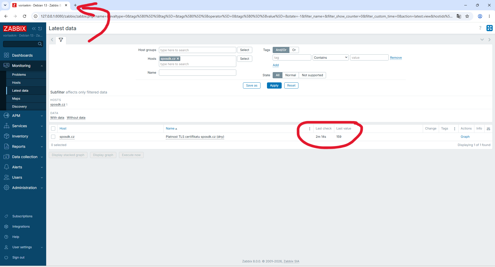

# Zabbix 8.0 LTS na Debian 13 (Trixie)


Školní projekt zaměřený na plně automatizované nasazení monitorovacího systému **Zabbix 8.0 LTS** pomocí nástroje Vagrant a shell/Python skriptů. Jako základní systém je použit **Debian 13 (Trixie)** (`bento/debian-13`) s databází MariaDB, webovým serverem Apache2 a klasickým Zabbix agentem.

Celé prostředí běží lokálně a po spuštění je webové rozhraní dostupné na adrese **http://127.0.0.1**.

---

## Požadavky a spuštění

Pro spuštění na hostitelském počítači je potřeba mít nainstalovaný **Vagrant**, **VirtualBox** a volné alespoň **4 GB RAM** pro virtuální stroj (VM je nakonfigurován na 3 vCPU a 4096 MB RAM).

V kořenové složce projektu stačí spustit:

```bash
vagrant validate
vagrant up
```

Provisioning proběhne kompletně bez zásahu uživatele. Všechny skripty se do VM kopírují pomocí `file` provisioneru, takže není potřeba řešit sdílené složky (`/vagrant`). Pokud by instalace selhala např. kvůli výpadku internetu při stahování balíčků, stačí po obnovení spojení spustit `vagrant provision` — skripty jsou idempotentní a již vytvořenou databázi ani hosty znovu nepřepisují.

---

## Jak instalace funguje

1. **Repozitáře a balíčky (`scripts/install.sh`)**: Skript přidá oficiální repozitář Zabbix 8.0 LTS pro Debian 13 a nainstaluje `zabbix-server-mysql`, `zabbix-frontend-php`, `zabbix-apache-conf`, `zabbix-sql-scripts`, `zabbix-agent` a `mariadb-server`.
2. **Databáze a zabezpečení**: V MariaDB se založí databáze `zabbix` (kódování `utf8mb4`) a vyhrazený uživatel. Heslo k databázi i nové heslo pro webového uživatele `Admin` se generují náhodně až uvnitř VM a ukládají se do `/var/db/zabbix-install/` s právy pouze pro `root` (v repozitáři tak nejsou žádná natvrdo zapsaná hesla).
3. **Webové rozhraní**: Konfigurační soubor `zabbix.conf.php` se vygeneruje automaticky, takže není nutné po instalaci procházet úvodní instalační průvodce v prohlížeči. Web běží na výchozí adrese `/zabbix`.
4. **Konfigurace přes Zabbix API (`scripts/configure_api.py`)**: Po nastartování služeb se spustí Python skript, který přes JSON-RPC API vytvoří host skupiny `SPOS Lab` a `Web Certificate`, přidá oba sledované hosty a nakonec přenastaví heslo účtu `Admin`.

### Přihlášení do webového rozhraní

Vygenerované heslo pro uživatele `Admin` si zobrazíš přímo z hostitelského terminálu:

```bash
vagrant ssh -c "sudo cat /var/db/zabbix-install/admin-password; echo"
```

Poté se přihlas na **http://127.0.0.1** jako `Admin`.

---

## Nastavený monitoring

| Host | Skupina | Popis kontroly |
| :--- | :--- | :--- |
| **spos-zabbix8** | `SPOS Lab` | Lokální monitoring samotného Zabbix serveru přes šablonu *Linux by Zabbix agent* (`127.0.0.1:10050`). |
| **sposdk.cz** | `SPOS Lab`, `Web Certificate` | Vlastní položka `sposdk.cert.days` (interval `1h`), která vrací počet dnů do vypršení TLS certifikátu webu `https://sposdk.cz`. |

---

## Řešené problémy během vývoje

* **Dostupnost a délka instalace**: Oproti nasazení na FreeBSD (kde je nutné Zabbix server zdlouhavě kompilovat z portů a VM vyžaduje 4 GB RAM) využívá Debian 13 předkompilované balíčky z oficiálního Zabbix repozitáře. Díky tomu se celá instalace zkrátila na pár minut a VM bez problému běží se 4 GB RAM.
* **Kontrola TLS certifikátu přes klasického agenta**: V projektu je nasazen klasický `zabbix-agent` (nikoliv Agent 2, který má šablonu *Website certificate* v základu). Pro zjištění platnosti certifikátu jsem proto napsal vlastní shell skript `/usr/local/libexec/zabbix/sposdk-cert-days.sh` využívající `openssl` a `date`, který je napojen přes `UserParameter=sposdk.cert.days`.
* **Specifika Zabbix 8.0 JSON-RPC API**: V nové verzi Zabbix 8.0 vyžaduje metoda `apiinfo.version` prázdné pole `[]` místo objektu `{}` a při změně hesla uživatele `Admin` přes `user.update` je povinné uvést i stávající heslo (`current_passwd`), jinak API vrátí chybu `Invalid params`.
* **Bezpečné opakování provisioningu (`vagrant provision`)**: Při ladění skriptů na Windows bylo nutné v `Vagrantfile` ošetřit konce řádků (`CRLF -> LF`) a v instalačních skriptech zajistit kontrolu existujících tabulek v DB, aby opakovaný běh `vagrant provision` neselhal.



---

## Rychlé ověření funkčnosti

Po dokončení `vagrant up` lze stav všech komponent ověřit uvnitř VM (`vagrant ssh`):

```bash
# Kontrola běžících služeb
sudo systemctl status mariadb zabbix-server zabbix-agent apache2

# Kontrola verzí Zabbixu
zabbix_server -V
zabbix_agentd -V

# Otestování vlastního UserParameteru pro certifikát
zabbix_agentd -t sposdk.cert.days
```

V prohlížeči pak v sekci **Monitoring → Latest data** stačí vyfiltrovat hosty `spos-zabbix8` a `sposdk.cz` a zkontrolovat naměřené hodnoty.
